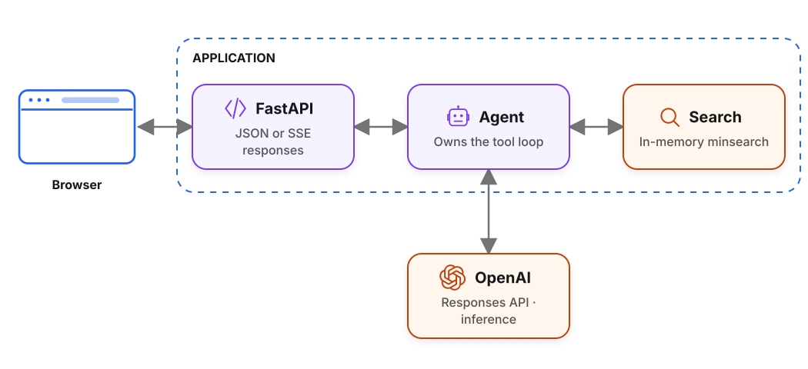

# End-to-End Agent Deployment

[Follow the tutorial on AI Shipping Labs](https://aishippinglabs.com/workshops/end-to-end-agent-deployment).

We use this directory for the workshop code from the AI Shipping Labs session "End-to-End Agent Deployment" on April 28, 2026.

> This copy adds **Langfuse tracing** on top of the workshop snapshot
> (Langfuse SDK + `@observe`). See [Tracing](#tracing) below.

## Overview

FastAPI streams results to the browser while the application's agent loop
exchanges model messages with OpenAI and executes FAQ searches locally:

<picture>
  <source media="(prefers-color-scheme: dark)" srcset="diagrams/overview-dark.svg">
  
</picture>

## Prerequisites

Install or configure these prerequisites:

- Python 3.13+
- OpenAI API key
- Docker if you want to build the container image

## Code Overview

We use these files to run the app:

- `app.py`: application entry point. On startup it initializes the FAQ search index and creates a shared Langfuse-wrapped `AsyncOpenAI` client. It exposes:
  - `GET /health` for a basic health check
  - `POST /ask` for a non-streaming JSON response
  - `POST /ask/stream` for a streaming SSE response
- `agent.py`: core agent loop. It sends the user question plus system instructions to the OpenAI Responses API (via Langfuse's wrapped `AsyncOpenAI`, so LLM calls are traced automatically), streams text deltas back through a renderer, inspects the model output for function calls, executes the `search` tool when requested, appends tool results back into message history, and repeats for up to 5 iterations. `run_agent` is wrapped in `@observe(as_type="agent")` so input/output appear in Langfuse.
- `search.py`: FAQ retrieval layer. It downloads the Data Engineering Zoomcamp FAQ JSON, builds an in-memory `minsearch` index over `question`, `answer`, and `section`, and exposes both the Python `search()` function (wrapped in `@observe(as_type="retriever")`) and the tool schema shown to the model.
- `renderer.py`: output adapters. `CollectingRenderer` accumulates streamed tokens plus tool call metadata so `/ask` can return one final JSON object. `SSEQueueRenderer` converts events into Server-Sent Events so `/ask/stream` can update the UI live.
- `schemas.py`: Pydantic API models. `AskRequest` validates the incoming question, while `AskResponse` and `ToolCall` define the structured response format for the non-streaming endpoint.
- `frontend/`: frontend source code. `main.js` posts a question to `/ask/stream`, parses incoming SSE chunks manually, renders assistant tokens as they arrive, and shows tool calls and tool results in expandable blocks. `index.html` provides the shell, and `style.css` defines the simple chat-style layout.
- `notebook.ipynb`: notebook version of the workshop code for exploring the same agent flow interactively.
- `Dockerfile`: production-style build. It first builds the frontend with Vite, then copies the generated frontend bundle into `./static` in the Python image, installs backend dependencies with `uv`, and starts `uvicorn`.
- `Makefile`: convenience commands for local backend runs, frontend dev mode, and Docker build/run.

## Request Flow

Follow this sequence for each request:

1. The frontend sends the user's question to `/ask/stream` or `/ask`.
2. FastAPI passes the question to `run_agent(...)`.
3. The agent asks the model for an answer and gives it one tool: `search(query)`.
4. If the model calls the tool, the backend searches the FAQ index and appends the results back into the conversation.
5. The loop continues until the model returns a final answer without another tool call.
6. The `/ask` and `/ask/stream` endpoints return JSON or SSE:
   - one JSON payload from `/ask`
   - a stream of SSE events from `/ask/stream`

## Frontend And Static Assets

These paths differ between local development and the container build:

- In development, the frontend source lives in `frontend/` and can be run with Vite.
- In the container build, Vite outputs compiled assets into `dist/`, and the Dockerfile copies that bundle into `static/`.
- `app.py` serves the frontend only when the `static/` directory exists, which is the production/container path.

## Running Locally

Start the local backend with:

```bash
uv sync --locked
export OPENAI_API_KEY=sk-...
uv run fastapi dev app.py
```

## Tracing

This copy adds Langfuse tracing (recommended SDK path).

### 1. Install

```bash
uv sync --locked   # installs langfuse, fastapi, openai, ...
cp .env.example .env  # then fill in keys
```

### 2. Configure (env vars)

| Var | Purpose |
|-----|---------|
| `OPENAI_API_KEY` | required, model access |
| `LANGFUSE_PUBLIC_KEY` / `LANGFUSE_SECRET_KEY` | required for tracing |
| `LANGFUSE_BASE_URL` | default `https://cloud.langfuse.com` (set to self-hosted host if needed) |

```bash
export LANGFUSE_PUBLIC_KEY=pk-lf-...
export LANGFUSE_SECRET_KEY=sk-lf-...
# optional: export LANGFUSE_BASE_URL=https://cloud.langfuse.com
```

How it works: `app.py` creates Langfuse's wrapped `AsyncOpenAI` (LLM calls
traced automatically with input/output, tokens, cost), `run_agent` uses
`@observe(as_type="agent")`, and `search` uses `@observe(as_type="retriever")`.
No manual span code.

### 3. What gets traced

- `agent.run` (one trace per `/ask` or `/ask/stream` request, input = question, output = answer)
- LLM generations (one per model call, nested automatically)
- `retrieval.minsearch` (per search call, input = query, output = results)

Try it:

```bash
curl localhost:8000/health
```

### 5. Self-host Langfuse (Docker Compose)

`docker-compose.yml` runs the full stack on one machine: Langfuse UI
(`:3331`) + worker + Postgres/ClickHouse/Redis/MinIO, plus this repo's
`faq-agent` (`:8000`) already wired to it.

```bash
cp .env.example .env   # then set OPENAI_API_KEY
make langfuse-secrets  # paste the 7 lines into .env, update DATABASE_URL password to match

docker compose up --build -d
docker compose logs -f langfuse-web   # wait for "Ready" (~2-3 min first boot)
open http://localhost:3331            # Sign up first user -> org -> project -> API keys
```

Then point the agent at your instance and restart just it:

```bash
# in .env (app on host):
LANGFUSE_BASE_URL=http://localhost:3331
LANGFUSE_PUBLIC_KEY=pk-lf-...
LANGFUSE_SECRET_KEY=sk-lf-...
# in compose the app uses http://langfuse-web:3000 automatically (see compose file);
# keys still come from .env, so set them there and run:
docker compose up -d faq-agent
curl -X POST localhost:8000/ask -H 'content-type: application/json' \
  -d '{"question": "When does the zoomcamp start?"}'
# check traces in http://localhost:3331
```

Notes:

- Only `:3331` (Langfuse UI) and `:8000` (agent) are exposed publicly;
  `:9090` is MinIO, databases are bound to `127.0.0.1`. On a VM, restrict
  inbound traffic to `:3331`/`:8000` and use a 4-core/16GB host with ~100GB disk.
- No default Langfuse login ships with the image — use Sign up, or skip the
  UI via headless init (`LANGFUSE_INIT_*` vars in `.env.example`).
- Upgrade later with `docker compose up --pull always`.
- Useful targets: `make stack-up|stack-down|stack-logs|stack-ps`.

## CI/CD

The repository uses this CI/CD setup:

- The source project includes `.github/workflows/deploy.yml`.
- That workflow deploys to Railway, not Fly.
- In this repository the code lives under a workshop subfolder, so the copied workflow is part of the snapshot, not an active repo-level workflow.
